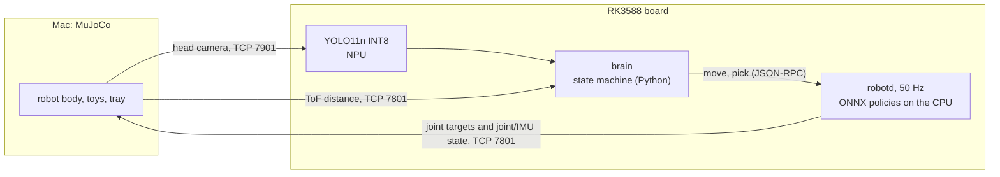

# MicroDuck on RK3588: toy retrieval

A small bipedal robot is told which toy to fetch. It searches the floor, walks to the toy, picks it up
with its beak, carries it to a tray and drops it in. The robot's software runs on an RK3588 board:
the 50 Hz control loop with its policy networks, the YOLO detector on the NPU and the state machine
that decides what to do. The body, head camera and distance sensor are simulated in MuJoCo on a Mac
and connect to the board over Ethernet. There is no physical robot in this project; the board runs
the same programs it would run on one.

**中文简介：** 在 RK3588 开发板上部署 MicroDuck 双足机器人的整套软件：50 Hz 控制环和 ONNX 策略网络、
NPU 上的 INT8 YOLO、做决策的状态机。身体、相机和测距传感器在 Mac 上的 MuJoCo 里仿真，通过网线和板子相连。
机器人按指令找到指定玩具，走过去叼起来，送进托盘。板上 INT8 版本在 60 局正式测试里送到 52 局（86.7%），
没有拿错，也没有摔倒。

## Results

Formal test (Stage 4): 3 target toys x 20 random layouts = 60 episodes per setup, each with a
180 s limit and at most 3 grasp attempts. Two look-alike distractors share the field: a crocodile
with Henry's colour and Thomas with Henry's shape. Brackets are Wilson 95% intervals.

| Setup | Delivered | Wrong toy | Falls | Mean time |
|---|---|---|---|---|
| **RK3588, YOLO INT8 on the NPU** (main) | **52/60 = 86.7%** [75.8, 93.1] | 0 | 0 | 37.0 s |
| Mac, YOLO FP32 on the CPU | 54/60 = 90.0% [79.8, 95.3] | 0 | 0 | 35.4 s |
| RK3588, YOLO FP16 on the NPU | 12/15 = 80.0% [54.8, 93.0] | 0 | 0 | 37.2 s |
| RK3588, YOLO FP32 on the CPU | 14/15 = 93.3% [70.2, 98.8] | 0 | 0 | 37.1 s |
| Mac, colour threshold instead of YOLO (baseline) | 40/60 = 66.7% [54.1, 77.3] | 8 | 0 | 50.0 s |

- Board INT8 and Mac FP32 are not significantly different (paired McNemar p = 0.79). The colour
  baseline is worse (p = 0.004): its 8 wrong grabs were all on Henry (6 took the crocodile, 2 took Thomas).
- Board INT8 failures: 6 episodes used up their three grasp attempts, 2 drops missed the tray.

Detection, offline on 2100 rendered test frames (Stage 2):

| Detector | Targets mAP50 | Search radius | Wrong grab near the robot |
|---|---|---|---|
| YOLO11n, COCO weights | 0.011 | 0 m | 0.5% |
| Colour threshold (HSV) | 0.929 | 1.8 m | 7.9% |
| YOLO11n fine-tuned, FP32 | 0.990 | 1.8 m | 0% |
| YOLO11n fine-tuned, INT8 on the RK3588 NPU | 0.990 | 1.8 m | 0% |

Detection time on the board in the closed loop (median over the episodes of each episode's P50 and P99):

| Backend | Inference P50 | End-to-end P50 | End-to-end P99 | Brain CPU |
|---|---|---|---|---|
| INT8, NPU | 7.1 ms | 32.0 ms | 45.8 ms | 17% of a core |
| FP16, NPU | 14.5 ms | 39.3 ms | 52.5 ms | 19% of a core |
| FP32, CPU (ONNX Runtime) | 49.0 ms | 71.3 ms | 84.3 ms | 38% of a core |

The camera sends 15 frames per second, one every 66 ms. Both NPU versions keep up; the CPU version
does not and skips frames, which the state machine tolerates. With INT8, preprocessing (19.8 ms)
takes longer than inference. Brain CPU is from 15 episodes per backend (seeds 1000-1004).

Known limits:

- Simulation only. A grasp holds the toy with a weld in MuJoCo when the beak closes on it; real
  contact is not modelled.
- In the 60 board INT8 episodes robotd missed 116 of 112,357 control ticks, more than the 8 the test
  allowed. The misses line up with stalls of the Mac sim body, not with load on the board.
- The C++ version of the board detector (`cpp/board_bench/`) is a skeleton: its preprocessing,
  postprocessing and RKNN wrapper are not written yet.

## How it works



- **Move:** `robotd`, Pollen Robotics' Rust runtime, runs the control loop at 50 Hz. Each tick turns
  joint angles and the IMU into a 61-number observation, runs a small ONNX network
  (61-512-256-128-14) and sends 14 joint targets. Three networks are used: `walk_17500` (walking,
  trained in this project), Pollen's `velstand` (standing, fall protection and getting up) and
  Pollen's `alpha_ground_pick` (crouch and pick).
- **See:** YOLO11n fine-tuned on 3500 images rendered in the sim, with six classes (3 targets,
  2 distractors, the tray). It looks at a window around the horizon, resized to 320 x 320. The model
  is exported with its 9 output tensors kept separate, so that INT8 quantization does not flatten the
  class scores, and converted with rknn-toolkit2.
- **Decide:** a rule-based state machine: spin and look, walk to the toy, approach, a short blind
  last step, pick, check that the toy is held, carry, look for the tray, drop. On the board it runs
  on cores 4-6 at nice 10; robotd has core 7 to itself.

## Stages

Each stage ended with a table of measured facts, and the next stage read its numbers only from there.

| Stage | What was settled | Facts |
|---|---|---|
| 0 | what the upstream robot can do: smallest reliable steps and turns, ground pick, getting up after a fall | `configs/control/stage0_facts.json` |
| 1 | field, toys, grasp in the sim, the last 25 cm (visual inching or a blind step), carrying | `configs/control/stage1_facts.json` |
| 2 | dataset, YOLO fine-tuning, ONNX and RKNN (FP16, INT8), offline accuracy and board timing | `configs/vision/stage2_facts.json` |
| 3 | the whole task end to end on the Mac and on the board; frozen at tag `stage3-freeze` | `configs/control/stage3_facts.json` |
| 4 | the formal 60-episode runs and comparisons; tag `stage4-results` | `results/stage4/` |
| 5 | a room demo with 12 toys and three deliveries in a row (branch `stage5-demo`, not a formal result) | |

## Repository layout

| Path | What |
|---|---|
| `src/microduck_toy/` | Python package: `stage0`-`stage3` (tests and the brain), `control/`, `vision/`, `scene/`, `sim/`, `rpc/` |
| `scripts/` | zsh launchers: `sim/` (Mac), `board/` (over SSH), `stage3/run_batch.zsh`, `stage4/` (tables), `tools/run_tests.zsh` |
| `configs/` | robotd configs, controller and vision settings, each stage's facts |
| `models/` | robotd policies (ONNX) and YOLO models (ONNX, RKNN) with their export and conversion records |
| `results/stage4/` | final tables (CSV, JSON) and figures |
| `sim/` | toy meshes and MuJoCo scenes |
| `tests/` | unit tests |
| `cpp/board_bench/` | C++17 board detector benchmark (skeleton) |
| `docs/` | plans, step guides (in Chinese), analyses and research notes |
| `third_party/` | upstream `microduck` and `microduck_rl` as git submodules |
| `runs/`, `data/`, `evidence/`, `offline/`, `references/` | local only; git keeps a README or a `MANIFEST.tsv` with sizes and SHA-256 |

The ball-following prototype that came first (2026-10-04 to 10-10: `archive/` and the G3/G4 step guides)
was removed from `main` on 2026-11-01; it is still in the history, at tag `stage4-results`.

## Running it

Needs a Mac with [uv](https://github.com/astral-sh/uv) and Rust 1.89. The board part also needs an
RK3588 board set up as in `configs/board/README_board.md`; board addresses and paths are the `MD_*`
variables in `env.sh`.

```zsh
git clone --recurse-submodules https://github.com/Baro7ue/microduck-rk3588-toy-retrieval.git "RK3588 Microduck"
cd "RK3588 Microduck"
(cd third_party/microduck_rl && uv sync --locked)
uv pip install --python third_party/microduck_rl/.venv/bin/python opencv-python-headless==4.11.0.86
zsh scripts/sim/build_mac_runtime.zsh
zsh scripts/tools/run_tests.zsh
```

One episode on the Mac, in three terminals, each started from the repository root:

```zsh
scripts/sim/stage1/run_arena_body.zsh --camera
scripts/sim/stage0/run_robotd.zsh s2
scripts/sim/stage3/run_test.zsh 3e --episodes 3000:bus
```

The same episode with robotd and the brain on the board:

```zsh
scripts/sim/stage1/run_arena_body.zsh --camera --board
scripts/board/stage0/run_board_robotd.zsh s2
scripts/board/stage3/run_board_brain.zsh 3e --episodes 3000:bus
```

The formal runs used `scripts/stage3/run_batch.zsh --target board --backend int8 --formal` and
`scripts/stage4/run_tables.zsh`. Every run writes its own folder under `runs/`.

## Credits and licence

- [Pollen Robotics](https://github.com/pollen-robotics): MicroDuck, its runtime, sim, training code
  and official policies.
- [Ultralytics](https://github.com/ultralytics/ultralytics) YOLO11n; Rockchip rknn-toolkit2.
- Google Scanned Objects, via [mujoco_scanned_objects](https://github.com/kevinzakka/mujoco_scanned_objects).

The project's own code and documents are under the Apache License 2.0 ([LICENSE](LICENSE)).
Third-party files keep their own licences, listed in [THIRD_PARTY_NOTICES.md](THIRD_PARTY_NOTICES.md);
the YOLO model files are AGPL-3.0. Where the models, data and documents came from is recorded in [PROVENANCE.md](PROVENANCE.md).
