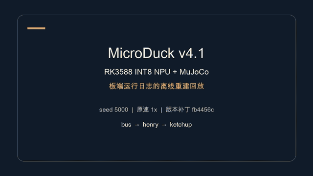
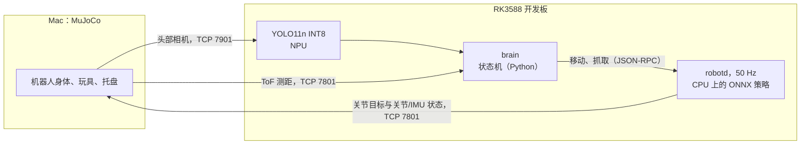

# MicroDuck on RK3588：取玩具

<p align="center">
  <a href="README.md"><kbd>&nbsp;English&nbsp;</kbd></a>
  &nbsp;
  <a href="README.zh-CN.md"><kbd>&nbsp;<b>简体中文</b>&nbsp;</kbd></a>
</p>

一个小型双足机器人按指令去取指定的玩具：先在地面上搜索，走到玩具旁，用嘴叼起来，带到托盘前放进去。
机器人的软件全部运行在 RK3588 开发板上：50 Hz 控制环和它的策略网络、NPU 上的 YOLO 检测器、做决策的状态机。
身体、头部相机和测距传感器在 Mac 上的 MuJoCo 里仿真，通过网线和开发板相连。
本项目没有实体机器人；开发板上运行的程序与在实体机器人上运行的相同。

## 演示

<p align="center">
  <a href="docs/media/stage5_room_demo_rk3588_int8.mp4">
    
  </a>
  <br>
  <sub>预览为 8 倍速。点击可看原速完整视频（2 分 42 秒，8.8 MB）。</sub>
</p>

阶段 5 房间演示：4.4 x 4.4 m 的房间，有家具和 12 个玩具。机器人按指令依次取回校车（bus）、Henry
和番茄酱瓶（ketchup），中间不重置，每次都站在碗沿外把玩具放进碗里。这一轮由 RK3588 运行 robotd、
brain 和 NPU 上的 YOLO11n INT8；Mac 仿真身体、相机和测距传感器。

- 这一轮（布局 seed 5000）在 155 s 内送达 3/3，没有跌倒，没有把玩具撞出，也没有碰到碗。
  它是演示，不是正式结果；一轮结果不代表成功率。
- 同一份代码在 Mac 上，seed 5000 和 5001 都送达 3/3；seed 5002 的那一轮在第一次看碗时被检查拦下
  （盘心偏 1.9 cm，门限 1.5 cm），当时还没有投放任何玩具。
- 板端这一轮里，第三次看碗只看到碗的一部分，退回用里程计（盘心偏 7.3 cm），玩具仍然进了碗。
- 视频是事后根据运行日志渲染的离线回放，不是实时录屏。
- 代码：分支 [`microduck-stage5-v4`](https://github.com/Baro7ue/microduck-rk3588-toy-retrieval/tree/microduck-stage5-v4)。

## 结果

正式测试（阶段 4）：3 种目标玩具 x 20 个随机布局 = 每种配置 60 局，每局限时 180 s，最多抓 3 次。
场地里有两个容易混淆的干扰物：颜色和 Henry 相同的鳄鱼，形状和 Henry 相同的 Thomas。
方括号里是 Wilson 95% 置信区间。

| 配置 | 送达 | 拿错玩具 | 跌倒 | 平均用时 |
|---|---|---|---|---|
| **RK3588，NPU 上的 YOLO INT8**（主配置） | **52/60 = 86.7%** [75.8, 93.1] | 0 | 0 | 37.0 s |
| Mac，CPU 上的 YOLO FP32 | 54/60 = 90.0% [79.8, 95.3] | 0 | 0 | 35.4 s |
| RK3588，NPU 上的 YOLO FP16 | 12/15 = 80.0% [54.8, 93.0] | 0 | 0 | 37.2 s |
| RK3588，CPU 上的 YOLO FP32 | 14/15 = 93.3% [70.2, 98.8] | 0 | 0 | 37.1 s |
| Mac，用颜色阈值代替 YOLO（基线） | 40/60 = 66.7% [54.1, 77.3] | 8 | 0 | 50.0 s |

- 板端 INT8 与 Mac FP32 没有显著差异（配对 McNemar 检验 p = 0.79）。颜色基线更差（p = 0.004）：
  它的 8 次拿错都发生在取 Henry 时（6 次拿了鳄鱼，2 次拿了 Thomas）。
- 板端 INT8 的失败：6 局用完了三次抓取机会，2 局投放时没有落进托盘。

检测，在 2100 张渲染的测试图上离线评估（阶段 2）：

| 检测器 | 目标 mAP50 | 搜索半径 | 近处拿错 |
|---|---|---|---|
| YOLO11n，COCO 权重 | 0.011 | 0 m | 0.5% |
| 颜色阈值（HSV） | 0.929 | 1.8 m | 7.9% |
| YOLO11n 微调，FP32 | 0.990 | 1.8 m | 0% |
| YOLO11n 微调，RK3588 NPU 上的 INT8 | 0.990 | 1.8 m | 0% |

闭环中板端的检测耗时（先取每局的 P50 和 P99，再对各局取中位数）：

| 后端 | 推理 P50 | 端到端 P50 | 端到端 P99 | brain 占用 CPU |
|---|---|---|---|---|
| INT8，NPU | 7.1 ms | 32.0 ms | 45.8 ms | 一个核的 17% |
| FP16，NPU | 14.5 ms | 39.3 ms | 52.5 ms | 一个核的 19% |
| FP32，CPU（ONNX Runtime） | 49.0 ms | 71.3 ms | 84.3 ms | 一个核的 38% |

相机每秒发 15 帧，即每 66 ms 一帧。两个 NPU 版本都跟得上；CPU 版本跟不上，会跳帧，状态机可以容忍。
INT8 下，预处理（19.8 ms）比推理更耗时。brain 的 CPU 占用来自每个后端 15 局（seed 1000-1004）。

已知限制：

- 只有仿真。嘴合在玩具上时，MuJoCo 用一个焊接约束把玩具固定住；没有对真实接触建模。
- 板端 INT8 的 60 局里，robotd 在 112,357 个控制周期中漏了 116 个，超过测试允许的 8 个。
  漏的周期与 Mac 仿真机体的停顿对得上，与板子的负载无关。
- 板端检测器的 C++ 版本（`cpp/board_bench/`）只是骨架：预处理、后处理和 RKNN 封装都还没有写。

## 工作原理



- **运动：** `robotd` 是 Pollen Robotics 的 Rust 运行时，以 50 Hz 运行控制环。每个周期把关节角和 IMU
  组成 61 维观测，运行一个小型 ONNX 网络（61-512-256-128-14），输出 14 个关节目标。
  用到三个网络：`walk_17500`（行走，本项目训练）、Pollen 的 `velstand`（站立、防摔和起身）、
  Pollen 的 `alpha_ground_pick`（下蹲并抓取）。
- **感知：** YOLO11n 在 3500 张仿真渲染图上微调，共六类（3 个目标、2 个干扰物、托盘）。
  它只看地平线附近的一个窗口，缩放到 320 x 320。导出模型时保留 9 个分开的输出张量，
  这样 INT8 量化不会把类别分数压平；再用 rknn-toolkit2 转换。
- **决策：** 基于规则的状态机：原地转圈搜索，走向玩具，靠近，最后一小步盲走，抓取，确认叼住，
  搬运，找托盘，投放。在板上它运行在 4-6 号核，nice 10；7 号核留给 robotd 独占。

## 阶段

每个阶段结束时都有一张实测事实表，下一阶段只从这张表里取数。

| 阶段 | 确定了什么 | 事实表 |
|---|---|---|
| 0 | 上游机器人能做什么：最小的可靠步长和转角、地面抓取、跌倒后起身 | `configs/control/stage0_facts.json` |
| 1 | 场地、玩具、仿真里的抓取、最后 25 cm（视觉小步或盲走一步）、搬运 | `configs/control/stage1_facts.json` |
| 2 | 数据集、YOLO 微调、ONNX 和 RKNN（FP16、INT8）、离线精度和板端耗时 | `configs/vision/stage2_facts.json` |
| 3 | 整个任务在 Mac 和板端端到端跑通；冻结于标签 `stage3-freeze` | `configs/control/stage3_facts.json` |
| 4 | 正式的 60 局测试和对比；标签 `stage4-results` | `results/stage4/` |
| 5 | 房间演示：12 个玩具，连续三次送进碗里（分支 `microduck-stage5-v4`，不是正式结果；见[演示](#演示)） | |

## 仓库结构

| 路径 | 内容 |
|---|---|
| `src/microduck_toy/` | Python 包：`stage0`-`stage3`（测试和 brain）、`control/`、`vision/`、`scene/`、`sim/`、`rpc/` |
| `scripts/` | zsh 启动脚本：`sim/`（Mac）、`board/`（通过 SSH）、`stage3/run_batch.zsh`、`stage4/`（表格）、`tools/run_tests.zsh` |
| `configs/` | robotd 配置、控制和视觉参数、各阶段的事实表 |
| `models/` | robotd 策略（ONNX）和 YOLO 模型（ONNX、RKNN），附导出和转换记录 |
| `results/stage4/` | 最终表格（CSV、JSON）和图 |
| `sim/` | 玩具网格和 MuJoCo 场景 |
| `tests/` | 单元测试 |
| `cpp/board_bench/` | C++17 板端检测器基准（骨架） |
| `docs/` | 计划、分步指南、分析和调研笔记（英文；中文原文在 `docs/zh/`）；`media/` 里是演示视频 |
| `third_party/` | 上游的 `microduck` 和 `microduck_rl`，以 git 子模块引入 |
| `runs/`、`data/`、`evidence/`、`offline/`、`references/` | 只在本地；git 里只保留 README 或带大小和 SHA-256 的 `MANIFEST.tsv` |

最早的追球原型（2026-10-04 至 10-10：`archive/` 和 G3/G4 分步指南）已于 2026-11-01 从 `main` 移除；
它仍在历史记录里，位于标签 `stage4-results`。

## 运行

需要一台装有 [uv](https://github.com/astral-sh/uv) 和 Rust 1.89 的 Mac。板端部分还需要一块按
`configs/board/README_board.md` 配置好的 RK3588 开发板；板子的地址和路径是 `env.sh` 里的 `MD_*` 变量。

```zsh
git clone --recurse-submodules https://github.com/Baro7ue/microduck-rk3588-toy-retrieval.git "RK3588 Microduck"
cd "RK3588 Microduck"
(cd third_party/microduck_rl && uv sync --locked)
uv pip install --python third_party/microduck_rl/.venv/bin/python opencv-python-headless==4.11.0.86
zsh scripts/sim/build_mac_runtime.zsh
zsh scripts/tools/run_tests.zsh
```

在 Mac 上跑一局，开三个终端，都从仓库根目录启动：

```zsh
scripts/sim/stage1/run_arena_body.zsh --camera
scripts/sim/stage0/run_robotd.zsh s2
scripts/sim/stage3/run_test.zsh 3e --episodes 3000:bus
```

同一局，把 robotd 和 brain 放到板上运行：

```zsh
scripts/sim/stage1/run_arena_body.zsh --camera --board
scripts/board/stage0/run_board_robotd.zsh s2
scripts/board/stage3/run_board_brain.zsh 3e --episodes 3000:bus
```

正式测试用的是 `scripts/stage3/run_batch.zsh --target board --backend int8 --formal` 和
`scripts/stage4/run_tables.zsh`。每次运行都会在 `runs/` 下写入自己的目录。

## 致谢与许可

- [Pollen Robotics](https://github.com/pollen-robotics)：MicroDuck 及其运行时、仿真、训练代码和官方策略。
- [Ultralytics](https://github.com/ultralytics/ultralytics) YOLO11n；Rockchip rknn-toolkit2。
- Google Scanned Objects，经由 [mujoco_scanned_objects](https://github.com/kevinzakka/mujoco_scanned_objects)。

本项目自己的代码和文档采用 Apache License 2.0（[LICENSE](LICENSE)）。
第三方文件保留各自的许可，列在 [THIRD_PARTY_NOTICES.md](THIRD_PARTY_NOTICES.md)；
YOLO 模型文件为 AGPL-3.0。模型、数据和文档的来源记录在 [PROVENANCE.md](PROVENANCE.md)。
