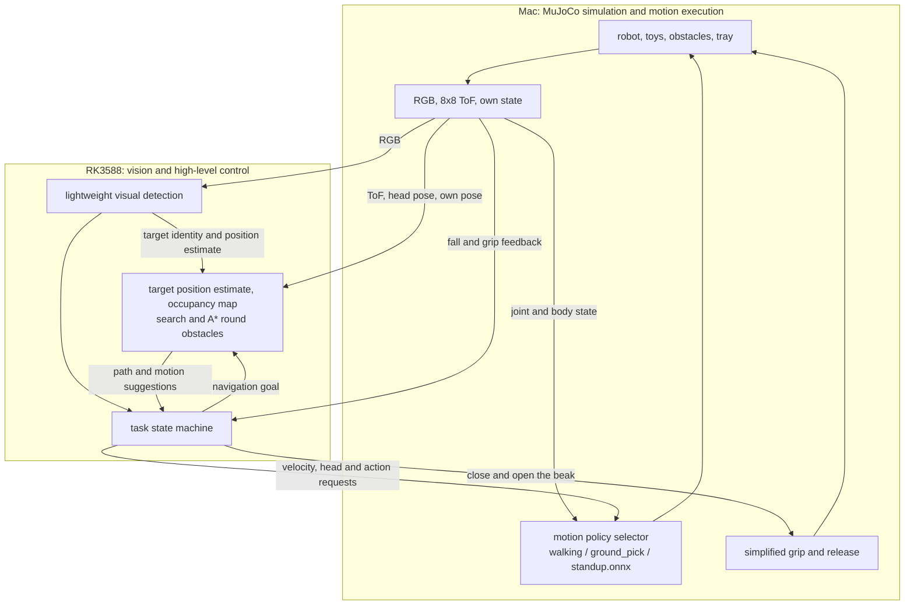

# MicroDuck: recognising a named toy, getting round obstacles and retrieving it. Overall plan and request for review

- Date of this document: 2026-10-11, Asia/Hong_Kong.
- Version: discussion draft v1, for independent technical review.
- Course background: CityU EE5438 Applied Deep Learning; the submitted project topic is **MicroDuck Selective Following**, and the proposal's main technical direction is visual recognition and target following.
- Career goal: an internship in embedded Linux / edge AI deployment.
- Status: this document collects the requirements and candidate designs discussed so far. It does not mean that new features are implemented, models trained or board experiments passed.

## 1. Request to the reviewer

Please review this plan independently and strictly. The main points to judge: whether the task is worth doing, whether the technical chain holds, whether the scope suits work done mainly by one person, and whether the contribution to the course and the value for an internship are clear.

Please do not merely restate the plan or assume every suggestion is right. Simpler alternative implementations are welcome, but please say which abilities, validation difficulty or workload they change. Confirmed requirements and the technical choices suggested below should be looked at separately.

The review output hoped for:

1. An overall conclusion: go ahead, go ahead with a smaller scope, or needs a major change, with reasons.
2. The key problems ordered by severity; for each, the problem, when it occurs, its effect and the smallest way to verify it.
3. Features to keep, postpone or drop, with reasons.
4. The minimum viable system for a first version and the order of implementation.
5. Whether the course experiment has clear enough learning content, baselines, fair comparisons and quantitative results.
6. Which results can support an embedded Linux / edge AI internship, and which only support experience in simulation or reproducing algorithms.
7. Information still needed from the user, starting with the few questions that would change the architecture or the schedule.

This task is a review only. Please do not change project code, install environments, start training, paid cloud jobs or external services. If the repository or the course material cannot be checked, please state the basis of your inferences and the uncertainty.

## 2. Project background and how the requirements evolved

The first idea was for the robot to watch a ball falling through the air, wait until it landed and then approach it round obstacles. After discussion the falling object was dropped, in favour of finding a named target among several toys on the ground and retrieving it.

The target is no longer limited to a ball; a shape better suited to the beak can be chosen. For the first version a rectangular building block with a distinct look, low mass and fixed size is suggested.

The user wants to use the official walking, pick posture and get-up abilities, and to reproduce the PPO training of picking and getting up. The three motion abilities use separate policy models, rather than merging vision, navigation and all body motion into one end-to-end model.

The project currently only requires the robot's body to run in simulation. The RK3588 can carry real on-board inference and control, but that still does not amount to validation on a physical robot.

## 3. Settled requirements and candidate details

### 3.1 Main requirements already settled

| Item | Current requirement |
|---|---|
| Core task | Find the named toy among several objects on the ground, approach it round obstacles, grip it, take it to a given container and release it |
| Falling object | Dropped: no detection in the air, trajectory prediction or waiting for a landing |
| Target shape | Not limited to a ball; a toy that is easy to grip may be chosen |
| Vision contribution | Visual recognition, target selection and following / approach stay the main line of the course work |
| Obstacles | Static, wide rectangular blocks about as tall as the robot; 2-3 planned for the first version |
| Form of grasp | A restricted, simplified grasp; gripping is only possible after aligning and closing the beak, and may fail |
| Runtime | MuJoCo simulation on the Mac; the RK3588 brought in step by step |
| Training resources | Colab is available; GPU model, quota, budget and longest run time still to be checked |
| Motion training | Reproduce the PPO of GroundPick and StandUp; walking reuses the existing stable baseline first |
| Internship direction | Embedded Linux / edge AI deployment |

### 3.2 Suggested details, still adjustable

- One named target and several distractor toys; one target retrieved at a time.
- The target is a light rectangular block; its size, mass and the beak's grip posture are fixed after a geometry check.
- The container is a tray with low sides, a wide opening and a clear visual marker, to make dropping easier.
- The target may be fully hidden by an obstacle for a while; the robot finds it again by searching and changing its viewpoint.
- Different individuals that look exactly the same need not be told apart; the target's attributes should be enough to distinguish it visually.
- The ground is flat, and layout generation guarantees a reachable route that is wide enough.
- The first version may use the robot's exact simulated pose, to concentrate on perception, planning and retrieval; SLAM is not brought in first.
- Motion starts from short moves, standing still to observe, and updating the target and the map; range and input validity are still checked while moving.

These details are the currently recommended plan and should not be mistaken for a finished implementation or a final scope approved by the teacher.

## 4. What the final demo should show

Example: the scene holds toys of different colours and shapes and wide rectangular obstacles, and the user names "the red rectangular block". The robot scans the scene, recognises and selects the target, goes round the obstacles, reaches a position the beak can work from, lowers its head and closes its beak, confirms the grip, takes the target to the tray and releases it.

If the target is lost, the grasp fails or the robot falls, the system has explainable recovery behaviour and logs. Recovery from a fall is first shown on its own in a controlled scene with enough room, before deciding whether to add it to every layout.

The demo screen is suggested to show the head RGB, detection results, the ToF / local map, the current task state, the active motion policy, grip feedback and key timings.

## 5. Overall architecture and deployment stages

### 5.1 Recommended division during development

| Place | Main duties |
|---|---|
| Mac | MuJoCo physics, robot and object models, RGB rendering, simulated ToF, running the motion policies, the simplified grip, independent scoring and replay |
| RK3588 | Visual detection, target selection and memory, map and navigation, task state machine, communication and run records |
| Colab / CUDA environment | Training the vision model and reproducing the official PPO training; not part of the real-time task loop |

The diagram below shows the layering during development. It does not say that all components of the existing repository are in these places now, nor does it ask for verified on-board components to be moved back to the Mac. Existing chains should be checked first and reused as far as possible.



A Mac-only integration can serve as the earliest baseline for troubleshooting. Once the board is in, the RGB must really go into the detection model and take part in the closed loop; replaying images or running the model offline does not complete that stage.

### 5.2 The full on-board deployment goal

- Visual detection: RK3588 NPU, the model converted from ONNX to RKNN.
- The three motion policies: RK3588 CPU, inferred with ONNX Runtime or a compatible backend.
- High-level target estimation, map, planning and task state machine: RK3588 CPU.
- Mac: keeps physics, rendering, sensor generation, enforcing the grip constraint and scoring.
- Network: observations from the Mac to the RK3588; control commands from the RK3588 back to the Mac.

Moving the motion policies must be checked separately for inference latency, control rate and policy switching. It cannot be assumed that small policies are faster on the NPU, nor may the partial on-board deployment of the development stage be written up as a full on-board motion loop.

## 6. Perception, localisation and vision / ToF fusion

### 6.1 Visual recognition

Train a lightweight object detector to recognise the target toy, the necessary distractor classes and the tray. The model version first follows a baseline that already exports and is supported by RKNN, and is then chosen from actual deployment results.

The target is named by observable attributes such as colour and shape. The output includes class, box, confidence and observation time; track ids used for association must be generated from observations and must not use the hidden identity of simulated objects.

Data is collected by rendering in simulation, varying layout, lighting, texture, viewing angle, distance, occlusion and toy placement. Labels may be generated from simulation truth, but inference and task control must use real RGB detection results.

### 6.2 Target position estimate and memory

- When the ground contact point is visible, the ground is flat and the camera intrinsics and extrinsics are valid, estimate the target position from the pixel ray and the ground geometry.
- The bottom edge of a box is not necessarily the object's contact point; under occlusion or cut-off it cannot be projected directly and taken as an accurate coordinate.
- A known object size gives an extra scale constraint, but variation in class size, pose and box error must go into the uncertainty.
- When distance cannot be estimated reliably, keep the bearing and change the viewpoint; do not output a false precise target coordinate.
- Keep the target estimate, reference frame, last observation time, quality / uncertainty and visibility; new visual observations keep correcting it.
- After the target is occluded, do not walk blind along the last direction indefinitely; check the map and the validity of the estimate first, then run a bounded search.

### 6.3 What ToF does and its limits

A simulated 8x8 ToF on the head is used for coarse obstacle ranging and local mapping. Field of view, zone directions, range and validity states should come from the chosen hardware / simulation model.

Each real ToF zone covers a finite angle; using the zone's centre ray is only an approximation and must be stated in the report. It does not naturally give an all-round view, and it cannot be assumed to see things at the feet, to the side and rear, or every small toy.

Fusion steps:

1. Match ToF, head joint state and robot pose by capture time.
2. Use the head's forward kinematics and the sensor extrinsics to bring the range directions into one frame.
3. Tell apart the ground, valid obstacle returns, valid no-returns and invalid measurements.
4. Update the three map states free, occupied and unknown, and keep the validity bounds.
5. Inflate obstacles by the robot's body and the sweep of its motion, then plan a passable route.

Vision answers "which object is the target and roughly where is it"; ToF answers "what nearby is occupied and whether the path is risky". Detection boxes and ToF cells do not correspond one to one; the nearest return in a cell may come from the foreground, the ground or an obstacle.

Areas that are unobserved or whose measurement is invalid cannot be taken as free. When the ToF is too sparse, the low blind zone matters or the map is not updated enough, this should be handled by scanning, conservative movement and limits on the scene; unconditional obstacle avoidance must not be claimed.

## 7. Search, planning and approach

A 2-D local occupancy grid with A* is suggested; the first version does not make the full ROS2 / Nav2 / SLAM a required dependency.

- Target visible: generate a safe approach position from the visual estimate and check that the map can reach it.
- Target not visible: choose a reachable viewpoint, sweep the head or turn under control, and look for a new view.
- Local map: records the observed area; unknown areas are observed first, then explored under a limited strategy.
- Path execution: turn the path into walking velocity and turning requests, execute it in segments and observe again.
- Close range: switch from path tracking to visual alignment, adjust the beak's position relative to the toy, then trigger the pick.

The difficulty of this design is not only A* itself but also the target position error, the ranging blind zones, the robot's swept envelope and how well a path can actually be executed. Whether a simpler obstacle-avoidance / viewpoint strategy should replace A* is an option the reviewer is asked to compare.

## 8. The three motion policies and their training

| Policy | Function | Current suggestion |
|---|---|---|
| `walking.onnx` | Takes velocity, head and other commands; walks and turns | Reuse the stable baseline first; retraining the gait from scratch is not required for the first version |
| `ground_pick.onnx` | Crouches, brings the beak near the ground, then stands again | Test the official weights, then reproduce the PPO; adjust the task only on clear evidence of failure |
| `standup.onnx` | Gets back to standing from the covered fallen / sitting initial states | Reproduce the PPO separately; join the main task once it meets the recovery condition |

The names above are example file names, not statements about the official weight file names or existing model paths.

### 8.1 What PPO covers

The official GroundPick and StandUp both use PPO. The input is mainly proprioceptive state and task commands, the output joint targets; visual target recognition and overall task scheduling sit above them.

GroundPick learns a body / neck motion: bring the beak tip near the ground, avoid hitting it, and stand back up. The task as checked has no manipulable toy; the effect of carrying something is approximated by an external load. It does not include a complete learned grasp with visual localisation of arbitrary toys, actively closing the beak, contact and bite, holding and releasing.

StandUp covers initial states such as lying face down, face up and sitting. SitStand is sitting down / standing up on command and cannot be equated with general recovery from a fall. Getting up on wheels and a joint walking-recovery policy are not required for the first version.

### 8.2 Training and export

1. Fix the repository version, robot model, training config and random seed, and complete a short run first.
2. Test the official policies first, to set a baseline of reachability and stability.
3. Reproduce the GroundPick PPO, keeping curves, checkpoints, config, exported model and evaluation videos.
4. Where necessary adjust the beak's reach height, orientation, dwell phase or load range; the grip criterion stays fixed across the comparison experiments.
5. Reproduce StandUp separately and evaluate recovery and the walking that follows.
6. Following the official export path, write the observation normalisation into the ONNX, and verify again in the final retrieval scene.

The official training is based on mjlab / MuJoCo Warp and needs a CUDA GPU. Colab's compatibility, throughput and cost must be measured first; no convergence time on any particular GPU is promised.

Continuing training needs a compatible training checkpoint. A public deployment ONNX cannot be taken as a resumable PPO training state; with only an ONNX, the source of a checkpoint must be solved first, or training restarted from the original recipe.

### 8.3 The policy-switching contract

The three policies are exported separately, and at any moment only the selected policy owns joint control. Observation order, action order, normalisation, control rate, command encoding and the robot's dynamics model must each be matched.

GroundPick's phase durations and exit moment must match the weights; an earlier source check found that the phase window differs between training and some demo calls, so it should be rechecked before new weights are connected, without concluding that the existing weights are invalid.

Fall trigger, successful recovery, timeout, falling again and behaviour while carrying must be clearly defined. The first version may release the grip and clear the carrying state on a fall, and observe and search again after standing up stably; the exact recovery rules must be verified in simulation.

## 9. The restricted, simplified grip

The first version uses an attachment model in simulation and does not train real contact, friction or bite physics.

A grip requires all of:

- The beak has carried out a close command.
- The toy is within the space in which gripping is allowed.
- Relative position, orientation and size satisfy preset geometric conditions.
- The current body state suits picking; a failure must be recordable.

The simulator may use internal geometric truth to judge whether the grip constraint holds and then create the attachment; this belongs to the physics / grip model, and these coordinates should not leak to the controller.

A grip cannot be decided automatically by the hidden label "this is the target the user named". A wrong object that meets the geometric conditions can be picked up too; whether the right object was chosen should be decided by vision and task logic, and counted by independent scoring.

The controller may receive a synthetic `holding` state, but it must be stated that this is simulation feedback and not a verified physical sensor. Running GroundPick once does not mean the grip succeeded; after lifting, during transport and after release the corresponding state must be judged.

Dropping uses the tray position that vision located and remembered, corrected by looking again on the way back. The tray's true world coordinates cannot be used directly as a control target; whether the drop succeeded is judged by the simulation's scoring.

## 10. Task state machine and communication

Main flow:

```text
target named
  -> scan and search
  -> confirm the target
  -> plan / approach round obstacles
  -> fine alignment
  -> crouch and close the beak
  -> confirm the grip
  -> find / reconfirm the tray
  -> return and align
  -> release
  -> confirm completion
```

Exception branches:

| Situation | Expected handling |
|---|---|
| Target lost for a while | Lower the estimate's confidence, check validity, go to re-observation or search |
| No safe path | Stop the approach, update the map or choose a new viewpoint |
| Grip failed | Record the cause, back off / adjust, retry a limited number of times |
| Object lost in transport | Update the carrying state, find and pick it again |
| Robot fell | Pause navigation, handle the grip state, get up and wait until stable |
| Stale observation, lost communication or control timeout | Stop motion requests, enter a recordable waiting / fault state |

Communicated data should carry a frame number, source capture time, reference frame, validity state and the necessary pose information. Clocks across machines need a mapping or synchronisation; a frame's arrival time alone cannot be taken as its exact capture time.

High-level requests and joint control should be distinguished by ownership and validity period. The transport first reuses the existing chain, then is adjusted by actual latency, throughput and fault behaviour.

## 11. Simulation truth and the credibility of experiments

| Information or use | Allowed? |
|---|---|
| The robot's own exact simulated pose | Allowed in the first version, as a stated simplifying assumption |
| Truth of objects / obstacles / tray for physics, sensor generation and data labels | Allowed |
| Object truth for the internal grip-constraint check and independent scoring | Allowed |
| The controller reading the true coordinates or hidden identity of the target, obstacles or tray | Not allowed |
| Passing a geometric mock detection off as the output of a real vision model | Not allowed |
| Using success in the Mac simulation in place of RK3588, NPU or physical-robot results | Not allowed |

All results are labelled separately: Mac local, board CPU, board NPU, Mac-RK3588 closed loop, physical robot. The last is not required at present.

## 12. Course experiment and efficiency evaluation

The suggested main research question: **when the edge-computing cost of detecting the named toy is lowered, can visual quality and the performance of the whole retrieval task be kept?**

Reproducing the PPO motions is verifiable learning and system content, but it is not assumed to be an original algorithmic contribution. The vision model, efficiency adjustments and fair comparison remain the main line of the course work.

### 12.1 Minimum experiment matrix

| Configuration | Use |
|---|---|
| HSV colour / shape rule | Non-deep-learning baseline |
| Fine-tuned lightweight detector, unquantised RKNN, input size S | On-board baseline of the learned model |
| Same detector, INT8, input size S | Isolates the effect of quantisation |
| Same detector, INT8, smaller input size | Isolates the effect of less input computation |

The actual numeric precision of an unquantised RKNN is whatever the tool and the runtime backend report; it cannot be asserted to be FP16 from the name alone. CPU ONNX can serve as a reference for output agreement and speed without another round of training.

If the first version's colour rule already does very well, that should be reported as it is. Test scenes may include lighting changes, occlusion, and distractors of the same colour but another shape or the same shape but another colour, but the target should stay visually distinguishable; an unfairly weak baseline must not be designed on purpose.

### 12.2 Fair comparison

- Split training, validation and test by scene / layout, so neighbouring video frames do not leak across sets.
- INT8 calibration data does not use the final test set.
- The validation set is for choosing configurations, the final test set for reporting.
- All detection configurations use paired scene seeds, the same task limits and fixed navigation, grip and motion policies.
- Models are frozen after motion training and tuning, so that motion changes do not mix into the comparison of vision efficiency.
- Report the successes / failures and the spread over repeated trials, not only the best video.

### 12.3 Metrics

| Level | Suggested records |
|---|---|
| Vision | Detection quality, target-selection accuracy, false / missed detections, re-acquisition after occlusion |
| Running system | Output differences after export / quantisation, p50 / p95 latency of inference and of the whole chain, memory, model size, timeouts and dropped frames |
| Motion | Reachability of the pick motion, fall rate, get-up success rate and time, walking after recovery |
| Retrieval task | Stage success rates for approach, grip, carrying and release; whole-task success rate, collisions, falls, time and failure causes |

Whole-task success means putting the named object into the tray and releasing it within the common limits on time and retries. Truth is used only for scoring. The exact thresholds, number of trials and efficiency goals are set after the baseline is done; no success rate or speed-up is promised in advance.

## 13. Order of work and stage acceptance

| Stage | Main outputs | Basis for moving on |
|---|---|---|
| P0 scene and interfaces | Toys, obstacles, tray, RGB / ToF / state, logs and random seeds | The source of observations, the frames and the timing can be checked |
| P1 selective approach | Real RGB detection, target selection, going round obstacles and re-observing | Picks the right target and approaches it in limited scenes, with failures recorded |
| P2 retrieval baseline | Ready-made motions, restricted grip, transport and release | End-to-end examples completed, failures counted per stage |
| P3 motion training | Own reproduction of GroundPick and StandUp, ONNX and evaluation | Runs in the final scene after export, with the switching contract correct |
| P4 on-board deployment | RK3588 NPU vision, CPU motion, cross-machine task loop | Actual run evidence for CPU, NPU and the closed loop, each separately |
| P5 comparison experiments and delivery | Fixed test scenes, efficiency / quality results, report and demo | The experiments can be reproduced, and course material traces back to configs and logs |

The board can be brought in earlier once the interfaces are stable; the table shows the order of dependencies and does not mean that an on-board chain that already works must be redone. Training the two new motions should not block the visual approach and the retrieval baseline for long.

The workload is planned for work done mainly by one person with limited time. The weekly plan, team division, the latest course deadline and the cloud training budget are not fixed in this document.

## 14. First-version priorities and limits of extension

Secure first: target selection from real RGB, approach round obstacles in limited scenes, retrieval with the restricted grip, on-board vision and reproducible experiments.

Then: reproduce the PPO of GroundPick and StandUp, and verify the scheduling and recovery of the motions in the whole system.

Later extensions: real contact grasping, more toy shapes and sizes, more complex obstacles, real pose estimation / SLAM, a joint walking-recovery policy, distillation or further optimisation of model structure, transfer to a physical robot.

If time is short, first reduce the number of scenes, the kinds of toys or the coverage of automatic recovery, keeping a clear baseline and experiments. The reviewer is asked especially to judge whether training two motions at once would squeeze the vision main line of the course, and whether the get-up training is better shown on its own first.

## 15. Course and internship deliverables

### 15.1 Course

The teacher's project page allows adjusting parameters and improving efficiency on top of an existing network, and also lists project types comparing DL with non-DL baselines. The proposal has to state the problem, goal, method, dataset, baselines and experimental setup; the presentation has to explain the algorithm, the theory and working program results.

According to the official site as checked on 2026-10-10, the submission includes a technical report PDF of 25 pages or more, a PPT, Python source code, a 3-4 minute demo video and an appendix of individual contributions, using the LaTeX report template linked there. Canvas and the teacher's latest requirements should be checked again before submitting; this document fixes no deadline.

The topic listed for this group on the official site is still **MicroDuck Selective Following**. How the added retrieval task lines up with the original proposal needs explaining in the report; a topic listed on the web page does not mean the teacher has confirmed this extension.

### 15.2 Internship

The checkable results hoped for:

- Export, verification and version records from training checkpoint to ONNX / RKNN.
- Actual CPU / NPU inference and performance analysis on RK3588 Linux.
- Process and cross-machine communication, timestamps, input validity, timeout recovery and run logs.
- Interface design and fault localisation across perception, planning, task state machine and motion policies.
- Reproducible experiments and failure analysis with fixed configs and scene seeds.

These results can support experience in edge AI and Linux application integration. Pure simulation cannot support statements of real driver development, a real camera chain, physical-robot reliability or transfer to real grasping.

## 16. Role of the reference projects and sources

The source code and course facts below were checked on **2026-10-10** in earlier discussion; no training or closed loop was rerun when this document was produced. Links pinned to a commit bound the version discussed then and do not suggest upgrading the local repositories automatically.

### 16.1 Official MicroDuck

- [microduck: the official runtime and robot project](https://github.com/pollen-robotics/microduck)
- [microduck_rl: the official training repository](https://github.com/pollen-robotics/microduck_rl)
- [training repository README, pinned commit](https://github.com/pollen-robotics/microduck_rl/blob/ceca01706143d729305baa94cbd8ab990979e325/README.md)
- [GroundPick config, pinned commit](https://github.com/pollen-robotics/microduck_rl/blob/ceca01706143d729305baa94cbd8ab990979e325/src/mjlab_microduck/tasks/microduck_ground_pick_env_cfg.py)
- [StandUp config, pinned commit](https://github.com/pollen-robotics/microduck_rl/blob/ceca01706143d729305baa94cbd8ab990979e325/src/mjlab_microduck/tasks/microduck_standup_env_cfg.py)
- [official deployment policy repository](https://huggingface.co/pollen-robotics/microduck-policies)

The official project provides the robot model, the motion policies and the basis for training and export. It cannot be concluded from this that finding toys by vision, ToF mapping, A*, the simplified grip and this plan's cross-machine retrieval loop are all implemented officially.

### 16.2 The microduck-lab community project

- [microduck-lab](https://github.com/jonathanhawkins/microduck-lab)
- [detailed notes of the version checked earlier](https://github.com/jonathanhawkins/microduck-lab/blob/bbf0326ef97975f7062368914e0729504d17226f/microduck_local/README.md)
- [geometric detection interface](https://github.com/jonathanhawkins/microduck-lab/blob/bbf0326ef97975f7062368914e0729504d17226f/microduck_local/src/microduck_local/sensors/detector.py)
- [Tidy retrieval behaviour](https://github.com/jonathanhawkins/microduck-lab/blob/bbf0326ef97975f7062368914e0729504d17226f/microduck_local/src/microduck_local/brain/tidy.py)
- [scene and grip implementation](https://github.com/jonathanhawkins/microduck-lab/blob/bbf0326ef97975f7062368914e0729504d17226f/microduck_local/src/microduck_local/world/arena.py)

This is the community's Mac / CPU MuJoCo prototype and training lab; its scenes, state machine, retrieval demo, simplified attachment and replay can serve as references. The detection interface of the version checked is a geometric simulation, not real image inference; a camera image on screen does not prove that the behaviour is driven by learned detections from that image.

To reuse it, it has to be replaced by real RGB detection, the hidden identities and noise-free truth isolated, and the RK3588 communication and closed loop implemented / verified. Its Mac training route cannot be equated with the official CUDA / mjlab recipe either.

### 16.3 Course

- [EE5438 Group Project page](https://eelmpo.github.io/ee5438/projects.html)
- [EE5438 course home page](https://eelmpo.github.io/ee5438/)

## 17. Technical questions to challenge in particular

1. Are monocular vision and a sparse head ToF enough to find the target and get round obstacles reliably in the given layouts? What should the minimum scene constraints be?
2. Is the exact own simulated pose a reasonable assumption for the first version? Which conclusions can then not be extrapolated?
3. Are a 2-D grid and A* necessary, or are a simpler viewpoint search and local avoidance enough? Please compare implementation cost and explainability.
4. How does target localisation stay credible when the toy's contact point is not visible, when it leaves the view at close range and while the head moves?
5. Does the official GroundPick's beak trajectory suit the chosen toy and tray? Should the toy geometry, the body motion or the grip condition be adjusted first? How to avoid manufacturing an improvement by loosening the criterion?
6. Do the transport load, crouching / rising and model switching need extra training or control? Which should get a geometric and dynamic check first?
7. Is recovery from a fall worth integrating in the first version? How to keep it from taking too much time, or from causing new failures near narrow obstacles?
8. Is the vision efficiency experiment enough to make a clear contribution to EE5438? How should dataset difficulty and the baselines be set to be fair?
9. Is the main risk in the RK3588 deployment operator support, quantisation, communication, the control period or system scheduling? What is the minimum order of verification?
10. With work done mainly by one person, which goals must be cut or postponed? Please give priorities with reasons, not the assumption that everything can be done on time.

Please write fact checks, engineering inferences and suggestions separately. For unknowns, list the smallest verification steps, and do not write experiments not yet run as results.
