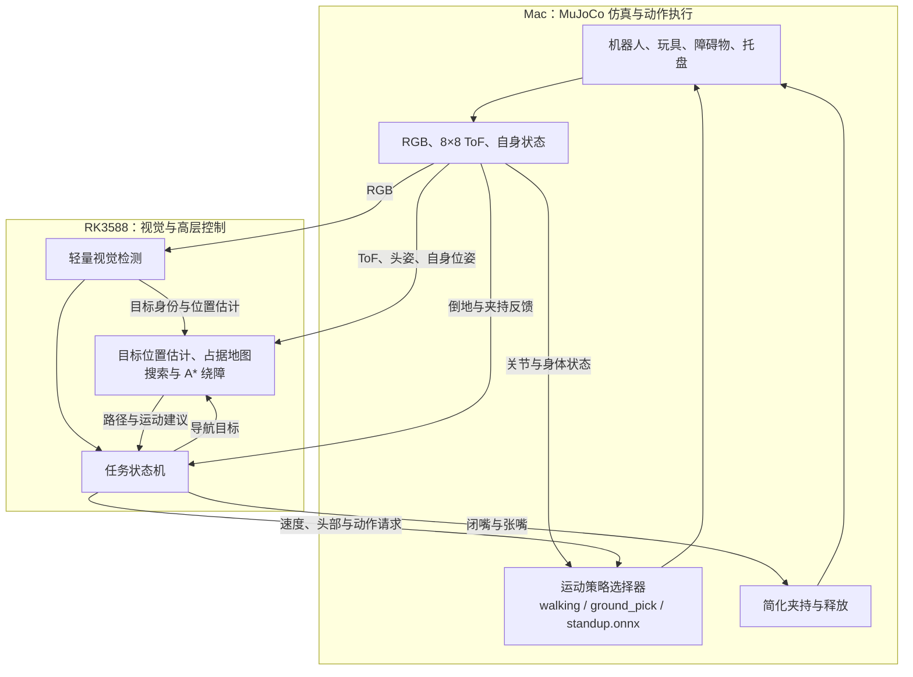

# MicroDuck 指定玩具识别、绕障与回收：总体方案与评估请求

- 文档日期：2026-10-11，Asia/Hong_Kong。
- 版本：讨论稿 v1，供独立技术评估。
- 课程背景：CityU EE5438 Applied Deep Learning；已提交项目方向为 **MicroDuck Selective Following**，proposal 的主要技术方向是视觉识别与目标跟随。
- 职业目标：嵌入式 Linux／边缘 AI 部署方向的实习。
- 状态：本文整理已讨论的需求与候选方案，不代表新增功能已经实现、模型已经训练或板端实验已经通过。

## 1. 给评估者的请求

请对本方案进行独立、严格的评估。重点判断：任务是否有价值、技术链路是否成立、范围是否适合主要由一人推进，以及课程贡献和实习展示价值是否清楚。

请不要仅复述方案或默认所有建议都正确。可以提出更简单的替代实现，但请明确它改变了哪些能力、验证难度或工作量。已确认需求与下文建议采用的技术选型应分开看待。

希望得到的评估输出：

1. 总体结论：建议执行、缩小范围后执行，或需要重大调整，并说明原因。
2. 按严重程度排序的关键问题；逐项说明问题、发生条件、影响和最小验证方法。
3. 保留、延后或删除的功能，以及理由。
4. 适合第一版的最小可行系统与实施顺序。
5. 课程实验是否有足够明确的学习内容、基线、公平对比与量化结果。
6. 哪些成果能支持嵌入式 Linux／边缘 AI 实习，哪些只能支持仿真或算法复现经历。
7. 尚需用户补充的信息，优先列出会改变架构或工期的少量问题。

本次任务仅为评估。请不要修改项目代码、安装环境、启动训练、付费云任务或外部服务。若无法核实仓库或课程资料，请说明推断依据和不确定性。

## 2. 项目背景与需求演变

最初设想是机器人观察空中落下的球，等球落地后绕障接近。经过讨论，已删除物体掉落这一要求，改为从地面多个玩具中寻找指定目标并回收。

当前目标不限定为球，可以选择更适合嘴部夹持的形状。第一版建议使用外观明显、质量较小、尺寸固定的长方体积木。

用户希望利用官方已有的行走、拾取姿态与倒地起立能力，并复现拾取和起立的 PPO 训练。三项运动能力采用独立策略模型，而不是把视觉、导航和全部身体动作合成一个端到端模型。

项目当前只要求机器人身体在仿真中运行。RK3588 可以承担真实板端推理与控制，但这仍不等于实体机器人的验证。

## 3. 已确定需求与候选细节

### 3.1 已确定的主要需求

| 项目 | 当前要求 |
|---|---|
| 核心任务 | 从地面多个物体中找出指定玩具，绕障接近，夹持后送到指定容器并释放 |
| 物体掉落 | 已删除，不需要空中检测、弹道预测或落地等待 |
| 目标形状 | 不限定为球，允许选择容易夹持的玩具 |
| 视觉贡献 | 保留视觉识别、目标选择和跟随／接近作为课程主线 |
| 障碍物 | 静态、宽长方体，高度接近机器人高度；初版按 2–3 个规划 |
| 抓取形式 | 受限的简化抓取；对准并闭嘴后才可能夹持，允许失败 |
| 运行环境 | Mac MuJoCo 仿真；逐步接入 RK3588 |
| 训练资源 | 有 Colab 可用；GPU 型号、可用额度、预算和最长运行时间仍需核对 |
| 动作训练 | 计划复现 GroundPick 与 StandUp 的 PPO；行走先复用已有稳定基线 |
| 实习方向 | 嵌入式 Linux／边缘 AI 部署 |

### 3.2 建议采用、仍可调整的细节

- 一个指定目标、多个干扰玩具，一次只回收一个目标。
- 目标使用轻质长方体积木；尺寸、质量、嘴部夹持姿态在几何验证后确定。
- 容器使用低边、宽口、带明显视觉标记的托盘，降低投放难度。
- 目标允许被障碍物暂时完全遮挡；机器人通过搜索和换观察位置重新找到目标。
- 无需区分外观完全相同的不同个体；目标属性应在视觉上足以区分。
- 地面平坦，布局生成保证存在足够宽的可达路线。
- 第一版允许使用准确的机器人自身仿真位姿，以把问题集中在感知、规划和回收，不优先引入 SLAM。
- 运动以短程移动、站稳观察、更新目标与地图为起点；移动期间仍检查测距与输入有效性。

这些细节属于当前推荐方案，不应被误认为已经完成的实现或教师认可的最终范围。

## 4. 最终演示应呈现什么

示例：场景内有不同颜色、形状的玩具及宽长方体障碍物，用户指定“红色长方体积木”。机器人扫描场景，识别并选中目标，绕过障碍，到达嘴部可操作的位置，低头闭嘴，确认夹持后将目标送入托盘并释放。

若目标丢失、抓取失败或机器人倒地，系统有可解释的恢复行为与日志。倒地恢复先在有足够空间的受控场景中单独演示，再决定是否接入所有布局。

演示界面建议显示头部 RGB、检测结果、ToF／局部地图、当前任务状态、活动运动策略、夹持反馈与关键耗时。

## 5. 总体架构与部署阶段

### 5.1 开发阶段的推荐分工

| 位置 | 主要职责 |
|---|---|
| Mac | MuJoCo 物理、机器人与物体模型、RGB 渲染、模拟 ToF、动作策略执行、简化夹持、独立评分和回放 |
| RK3588 | 视觉检测、目标选择与记忆、地图与导航、任务状态机、通信和运行记录 |
| Colab／CUDA 环境 | 视觉模型训练及官方 PPO 训练流程复现；不承担实时任务闭环 |

下图表示开发分层，不表示现有仓库的所有组件目前都在这些位置，也不要求把已验证的板端组件迁回 Mac。已有链路应先检查并尽量复用。



纯 Mac 集成可作为最早的排障基线。接入板端后，RGB 必须实际传入检测模型并参与闭环；只回放图像或离线跑模型不算完成该阶段。

### 5.2 完整板端部署目标

- 视觉检测：RK3588 NPU，模型经 ONNX 转换为 RKNN。
- 三份运动策略：RK3588 CPU，通过 ONNX Runtime 等兼容后端推理。
- 高层目标估计、地图、规划和任务状态机：RK3588 CPU。
- Mac：保留物理、渲染、传感器生成、夹持约束执行与评分。
- 网络传输：观测从 Mac 到 RK3588；控制指令从 RK3588 返回 Mac。

运动策略迁移必须单独核对推理时延、控制频率和策略切换。不能预设小型策略用 NPU 更快，也不能把开发阶段的部分板端部署写成完整板端运动闭环。

## 6. 感知、定位与视觉／ToF 融合

### 6.1 视觉识别

训练一个轻量目标检测器，识别目标玩具、必要的干扰类别和托盘。具体模型版本优先沿用已经能导出、能被 RKNN 支持的基线，再依据实际部署结果选择。

目标由可观察属性指定，例如颜色与形状。输出包括类别、检测框、置信度和观测时间；用于关联的轨迹编号必须由观察生成，不能直接使用仿真物体的隐藏身份。

数据由仿真渲染采集，可变化布局、光照、纹理、观察角度、距离、遮挡和玩具摆放。标签可以由仿真真值生成，但推理与任务控制必须使用真实 RGB 检测结果。

### 6.2 目标位置估计与记忆

- 在地面接触点可见、地面平坦、相机内外参有效时，通过像素射线与地面几何估计目标位置。
- 检测框下缘不一定是物体接触点；遮挡和裁切时不能直接投影并当成准确坐标。
- 已知物体尺寸可提供辅助尺度约束，但类别尺寸变化、姿态和检测框误差需计入不确定性。
- 距离不可可靠估计时，保留方位并改变观察位置；暂不输出虚假的精确目标坐标。
- 保存目标估计、参考系、最后观测时间、质量／不确定度与可见性；新视觉观测持续校正。
- 目标被遮挡后，不无限期沿最后方向盲走；先检查地图和估计有效性，再执行有界搜索。

### 6.3 ToF 的职责与限制

模拟头部 8×8 ToF，用于粗略障碍测距和局部建图。视场、区域方向、量程和有效状态应由所选硬件／仿真模型确定。

每个真实 ToF 区域有有限角范围；使用区域中心射线只是近似，需要在报告中说明。它不能自然提供全向视野，也不能假设能看清脚边、侧后方或所有细小玩具。

融合步骤：

1. 按采集时间匹配 ToF、头部关节状态及机器人姿态。
2. 用头部正运动学和传感器外参，把测距方向转换到统一坐标系。
3. 区分地面、有效障碍回波、有效无回波及无效测量。
4. 更新空闲、占据、未知三种地图状态，并保留有效性边界。
5. 结合机器人身体与运动扫掠范围膨胀障碍，再规划可通过路线。

视觉回答“哪个物体是目标、目标大概在哪里”，ToF 回答“附近哪里被占据、路径是否有风险”。视觉检测框与 ToF 格子不具有简单的一一对应关系；格子中的最近回波可能来自前景、地面或障碍物。

未观测或测量无效的区域不能直接当作空闲。ToF 过稀、低位盲区或地图更新不足时，应通过扫描、保守移动和场景限制处理，不能宣称无条件避障。

## 7. 搜索、规划与接近

建议采用二维局部占据栅格和 A*，初版不把完整 ROS2／Nav2／SLAM 作为必需依赖。

- 目标可见：根据视觉估计生成安全接近位置，并检查地图可达性。
- 目标不可见：选择可达的观察位置，扫头或受控转向，寻找新视野。
- 局部地图：记录已观测区域；未知区域先观察，再按限定策略探索。
- 路径执行：将路径转换为行走速度与转向请求，分段执行并重新观察。
- 近距离：从路径跟踪切换到视觉对齐，调整嘴部与玩具的相对位置，再触发拾取。

该方案的难点不只是 A* 本身，还包括目标位置误差、测距盲区、机器人扫掠包络和路径实际执行能力。是否用更简单的绕障／观察点策略替代 A*，是希望评估者比较的选项。

## 8. 三个运动策略与训练

| 策略 | 功能 | 当前建议 |
|---|---|---|
| `walking.onnx` | 接受速度、头部等命令，实现行走与转向 | 先复用稳定基线；步态从零重训不列为第一版必需项 |
| `ground_pick.onnx` | 下蹲，让嘴部接近地面，再恢复站立 | 测试官方权重后复现 PPO；有明确失败证据时再调整任务 |
| `standup.onnx` | 从覆盖的倒地／坐姿初态恢复站立 | 独立复现 PPO，达到恢复条件后再接入主任务 |

上述是示例文件名，不是对官方权重文件名或现有模型路径的声明。

### 8.1 PPO 的作用范围

官方 GroundPick 和 StandUp 均采用 PPO。输入主要是本体状态与任务命令，输出是关节目标；视觉目标识别和全局任务调度位于其上层。

GroundPick 学的是身体／颈部动作：让嘴尖接近地面、避免撞地、再站回。已检查的任务中没有可操作玩具实体；携物影响以外力负载近似。它不包含任意玩具的视觉定位、主动闭嘴、接触咬合、保持和释放的完整学习抓取。

StandUp 覆盖俯卧、仰卧、坐姿等初始化。SitStand 是命令坐下／站起，不能直接等同于一般倒地恢复。轮式起立与联合行走恢复策略不列为初版必需项。

### 8.2 训练与导出

1. 固定仓库版本、机器人模型、训练配置和随机种子，先完成短运行检查。
2. 先测试官方策略，建立动作可达性与稳定性基线。
3. 复现 GroundPick PPO，保留曲线、checkpoint、配置、导出模型和评估视频。
4. 有必要时调整嘴部到达高度、朝向、停留阶段或负载范围；夹持判据在对比实验中保持固定。
5. 独立复现 StandUp，评估恢复和后续行走。
6. 按官方导出路径把观测归一化一并写入 ONNX，在最终回收场景中复验。

官方训练基于 mjlab／MuJoCo Warp，需要 CUDA GPU。Colab 的兼容性、吞吐和成本需先实测，不承诺某种 GPU 上的收敛时间。

继续训练需要兼容的训练 checkpoint。公开部署 ONNX 不能直接视为可恢复的 PPO 训练状态；若只有 ONNX，应先解决 checkpoint 来源或按原配方重新训练。

### 8.3 策略切换契约

三份策略独立导出，同一时刻只有选定策略拥有关节控制权。需要逐一匹配观测顺序、动作顺序、归一化、控制频率、命令编码和机器人动力学模型。

GroundPick 的阶段时长与退出时刻必须匹配权重；之前源码核对已发现训练与部分演示调用的相位窗口有差异，接新权重前应复查，不能直接推断现成权重失效。

倒地触发、恢复成功、超时、再次跌倒和携物时的行为必须有明确定义。初版可在倒地时解除夹持并清除携物状态，稳定起立后重新观察和寻找；具体恢复规则需在仿真中验证。

## 9. 受限简化夹持

初版采用仿真附着模型，不训练真实接触、摩擦与咬合物理。

夹持需要同时满足：

- 嘴部已执行闭合命令。
- 玩具处于允许夹持的空间范围。
- 相对位置、方向和尺寸满足预定几何条件。
- 当前身体状态适合拾取；失败必须可被记录。

仿真器可使用内部几何真值判断夹持约束是否满足，再建立附着关系；这属于物理／夹持模型，不应把这些坐标泄露给控制器。

夹持不能由“这是用户指定目标”这一隐藏标签自动决定。符合几何条件的错误物体也可能被夹起；是否选对物体应由视觉与任务逻辑决定，并由独立评分统计。

控制器可接收合成的 `holding` 状态，但必须说明它是仿真反馈，不是已经验证的实体传感器。执行一次 GroundPick 不等于夹持成功；抬起后、运送期间和释放后都需要对应状态判断。

投放使用已视觉定位并记忆的托盘位置，返回时重新观察校正。托盘真实世界坐标不能直接作为控制目标；放入成功由仿真评分判断。

## 10. 任务状态机与通信

主流程：

```text
指定目标
  → 扫描搜索
  → 确认目标
  → 规划／绕障接近
  → 精细对齐
  → 下蹲与闭嘴
  → 确认夹持
  → 寻找／重新确认托盘
  → 返回并对齐
  → 释放
  → 确认完成
```

异常分支：

| 情况 | 预期处理 |
|---|---|
| 目标暂时丢失 | 降低估计可信度，检查有效性，转入重新观察或搜索 |
| 无安全路径 | 停止接近，更新地图或选择新的观察位置 |
| 夹持失败 | 记录原因，退开／调整后有限次重试 |
| 运输时丢物 | 更新携物状态，重新寻找和拾取 |
| 机器人倒地 | 暂停导航，处理夹持状态，执行起立并等待稳定 |
| 观测过期、通信中断或控制超时 | 停止运动请求，进入可记录的等待／故障状态 |

通信数据应带帧序号、源采集时间、参考系、有效状态和必要的姿态信息。跨机时钟需要映射或同步；不能仅把帧到达时间当作准确拍摄时间。

高层请求与关节控制应区分所有权和有效期。传输方式优先复用现有链路，再根据实际延迟、吞吐和故障行为决定调整。

## 11. 仿真真值与实验可信度

| 信息或用途 | 是否可用 |
|---|---|
| 机器人自身准确仿真位姿 | 初版允许，作为公开的简化假设 |
| 物体／障碍／托盘真值用于物理、传感器生成、数据标签 | 允许 |
| 物体真值用于内部夹持约束判定与独立评分 | 允许 |
| 控制器直接读取目标、障碍、托盘的真实坐标或隐藏身份 | 不允许 |
| 把几何 mock 检测当作真实视觉模型输出 | 不允许 |
| 用 Mac 仿真成功替代 RK3588、NPU 或实体机器人结果 | 不允许 |

所有结果分开标注：Mac 本地运行、板端 CPU、板端 NPU、Mac–RK3588 闭环、实体机器人。当前不要求最后一项。

## 12. 课程实验与效率评估

主要研究问题建议为：**降低指定玩具检测的边缘计算成本时，能否保持视觉质量和完整回收任务的表现？**

PPO 动作复现作为可验证的学习与系统内容，但不默认它已经形成原创算法贡献。视觉模型、效率调整和公平对比仍是课程主线。

### 12.1 最小实验矩阵

| 配置 | 用途 |
|---|---|
| HSV 颜色／形状规则 | 非深度学习基线 |
| 微调轻量检测器，非量化 RKNN，输入尺寸 S | 学习模型的板端基线 |
| 同一检测器，INT8，输入尺寸 S | 隔离量化影响 |
| 同一检测器，INT8，更小输入尺寸 | 隔离减少输入计算的影响 |

非量化 RKNN 的实际计算精度以工具与运行后端报告为准，不能仅凭名称断言是 FP16。CPU ONNX 可作为输出一致性与速度参照，不必新增一套训练。

如果第一版颜色规则表现已经很好，应如实报告。测试场景可以包含光照变化、遮挡、同色不同形或同形不同色的干扰，但应保持目标在视觉上可区分，不能专门设计不公平的弱基线。

### 12.2 公平比较

- 按场景／布局划分训练、验证和测试，避免相邻视频帧跨集合泄漏。
- INT8 校准数据不使用最终测试集。
- 验证集用于选择配置，最终测试集用于报告。
- 各检测配置使用成对的场景种子、相同任务限制和固定的导航、夹持及运动策略。
- 动作训练与调参完成后冻结模型，避免把动作变化混入视觉效率对比。
- 报告重复试验的成功／失败次数和波动；不只展示最佳视频。

### 12.3 指标

| 层次 | 建议记录 |
|---|---|
| 视觉 | 检测质量、目标选择正确率、误检／漏检、遮挡后重获表现 |
| 运行系统 | 导出／量化输出差异、推理与整链路 p50／p95 延迟、内存、模型大小、超时与丢帧 |
| 动作 | 拾取动作可达性、跌倒率、起立成功率与时间、恢复后行走能力 |
| 回收任务 | 接近、夹持、搬运、释放的阶段成功率；整任务成功率、碰撞、跌倒、耗时和失败原因 |

整任务成功需要在统一时间与重试上限内，将指定物体放入托盘并释放。真值仅用于评分。具体阈值、试验次数及效率目标在基线完成后确定，不提前承诺某个成功率或加速倍数。

## 13. 推进顺序与阶段验收

| 阶段 | 主要输出 | 进入下一阶段的依据 |
|---|---|---|
| P0 场景与接口 | 玩具、障碍、托盘、RGB／ToF／状态、日志与随机种子 | 能检查观测来源、坐标系和时间关系 |
| P1 选择性接近 | 真实 RGB 检测、目标选择、绕障与重新观察 | 在限定场景中选对目标并接近，保留失败记录 |
| P2 回收基线 | 现成动作、受限夹持、运输与释放 | 完成端到端样例，逐阶段统计失败 |
| P3 动作训练 | 自己复现的 GroundPick、StandUp、ONNX 与评估 | 导出后在最终场景可运行，切换契约正确 |
| P4 板端部署 | RK3588 NPU 视觉、CPU 运动、跨机任务闭环 | 分别取得 CPU、NPU 和闭环的实际运行证据 |
| P5 对比实验与交付 | 固定测试场景、效率／质量结果、报告与演示 | 实验可复现，课程材料能追溯到配置和日志 |

板端接入可在接口稳定后提前进行；阶段表表示依赖顺序，不表示必须把已经工作的板端链路重新做一遍。两个新增动作的训练不应长期阻塞视觉接近和回收基线。

工作量按主要由一人推进、时间有限规划。具体周计划、团队分工、课程最新截止日期和云训练预算尚未在本文中锁定。

## 14. 第一版优先级与扩展边界

优先保证：真实 RGB 选择目标、有限场景绕障接近、受限夹持回收、板端视觉与可复现实验。

随后完成：GroundPick 与 StandUp 的 PPO 复现，以及动作在完整系统中的调度与恢复验证。

后续扩展：真实接触抓取、更多玩具形状和尺寸、更复杂障碍、真实位姿估计／SLAM、联合行走恢复策略、蒸馏或进一步模型结构优化、实体机器人迁移。

若工期紧张，应先减少场景数量、玩具种类或自动恢复覆盖范围，保留清楚的基线与实验。请评估者特别判断：同时训练两项动作是否会挤压课程视觉主线，起立训练是否适合先单独演示。

## 15. 课程与实习交付

### 15.1 课程

教师项目页允许基于已有网络调整参数和提升效率，也列出了 DL 与非 DL 基线对比的项目类型。方案需要明确问题、目标、方法、数据集、基线和实验设置；展示需解释算法、理论及可工作的程序结果。

根据 2026-10-10 核对的官网内容，提交材料包括 25 页以上技术报告 PDF、PPT、Python 源码、3–4 分钟演示视频与个人贡献附录，并使用其链接的 LaTeX 报告模板。提交前应再次核对 Canvas 和教师最新要求；本文不锁定具体截止日期。

官网列出的本组题目仍是 **MicroDuck Selective Following**。新增回收任务如何与原 proposal 对齐，需要在报告中解释；网页列出题目不等于教师已经确认本次扩展。

### 15.2 实习

希望形成以下可检查成果：

- 从训练 checkpoint 到 ONNX／RKNN 的导出、验证与版本记录。
- RK3588 Linux 上实际 CPU／NPU 推理和性能分析。
- 进程与跨机通信、时间戳、输入有效性、超时恢复与运行日志。
- 感知、规划、任务状态机和动作策略的接口设计与故障定位。
- 固定配置和场景种子下的可复现实验与失败分析。

这些成果能支持边缘 AI 与 Linux 应用集成经历。纯仿真不能支持已完成真实驱动开发、真实摄像头链路、实体机器人可靠性或真实抓取迁移的表述。

## 16. 参考项目的角色与资料来源

以下源码与课程事实在此前讨论中于 **2026-10-10** 核对；本文生成时未重新运行训练或闭环。固定提交链接用于界定当时讨论的版本，不代表建议自动升级本地仓库。

### 16.1 官方 MicroDuck

- [microduck：官方运行时与机器人项目](https://github.com/pollen-robotics/microduck)
- [microduck_rl：官方训练仓库](https://github.com/pollen-robotics/microduck_rl)
- [训练仓库 README，固定提交](https://github.com/pollen-robotics/microduck_rl/blob/ceca01706143d729305baa94cbd8ab990979e325/README.md)
- [GroundPick 配置，固定提交](https://github.com/pollen-robotics/microduck_rl/blob/ceca01706143d729305baa94cbd8ab990979e325/src/mjlab_microduck/tasks/microduck_ground_pick_env_cfg.py)
- [StandUp 配置，固定提交](https://github.com/pollen-robotics/microduck_rl/blob/ceca01706143d729305baa94cbd8ab990979e325/src/mjlab_microduck/tasks/microduck_standup_env_cfg.py)
- [官方部署策略库](https://huggingface.co/pollen-robotics/microduck-policies)

官方提供机器人模型、运动策略、训练与导出基础。不能据此认为视觉寻找玩具、ToF 建图、A*、简化夹持和本方案的跨机回收闭环都已由官方实现。

### 16.2 microduck-lab 社区项目

- [microduck-lab](https://github.com/jonathanhawkins/microduck-lab)
- [此前核对版本的详细说明](https://github.com/jonathanhawkins/microduck-lab/blob/bbf0326ef97975f7062368914e0729504d17226f/microduck_local/README.md)
- [几何检测接口](https://github.com/jonathanhawkins/microduck-lab/blob/bbf0326ef97975f7062368914e0729504d17226f/microduck_local/src/microduck_local/sensors/detector.py)
- [Tidy 回收行为](https://github.com/jonathanhawkins/microduck-lab/blob/bbf0326ef97975f7062368914e0729504d17226f/microduck_local/src/microduck_local/brain/tidy.py)
- [场景与夹持实现](https://github.com/jonathanhawkins/microduck-lab/blob/bbf0326ef97975f7062368914e0729504d17226f/microduck_local/src/microduck_local/world/arena.py)

这是社区的 Mac／CPU MuJoCo 原型与训练实验室，可参考场景、状态机、回收演示、简化附着和回放。其已核对版本的检测接口是几何模拟，不是实际图像推理；画面显示相机图像不证明行为由该图像中的学习检测结果驱动。

若复用，需要替换为真实 RGB 检测、隔离隐藏身份与无噪声真值，并实现／验证 RK3588 通信与闭环。其 Mac 训练路线也不能直接等同于官方 CUDA／mjlab 配方。

### 16.3 课程

- [EE5438 Group Project 页面](https://eelmpo.github.io/ee5438/projects.html)
- [EE5438 课程首页](https://eelmpo.github.io/ee5438/)

## 17. 希望重点质疑的技术问题

1. 单目视觉与稀疏头部 ToF 是否足以在规定布局中可靠找到目标并绕障？最小场景约束应是什么？
2. 准确自身仿真位姿是否是合理的第一版假设？哪些结论因此不能外推？
3. 二维栅格与 A* 是否必要，还是更简单的观察点搜索和局部绕障足够？请比较实现成本与可解释性。
4. 玩具接触点不可见、近距离离开视野和头部运动时，目标定位如何保持可信？
5. 官方 GroundPick 的嘴部轨迹是否适合选定玩具和托盘？应该先调整玩具几何、身体动作，还是夹持条件？怎样避免人为放宽判据制造提升？
6. 运输负载、下蹲／起身和模型切换是否需要额外训练或控制？哪些应先做几何与动力学验证？
7. 倒地恢复是否值得作为第一版集成功能？如何避免它占用过多时间，或在狭窄障碍附近产生新的失败？
8. 视觉效率实验是否足以形成 EE5438 的明确贡献？数据集难度和基线如何设置才公平？
9. RK3588 部署中的风险主要在算子支持、量化、通信、控制周期还是系统调度？最小验证次序是什么？
10. 在主要由一人推进的前提下，哪些目标必须删减或延后？请给出有依据的优先级，而不是默认全部能按时完成。

请将事实核对、工程推断和建议分开写。对未知内容列出最小验证步骤，不把尚未执行的实验写成结果。
